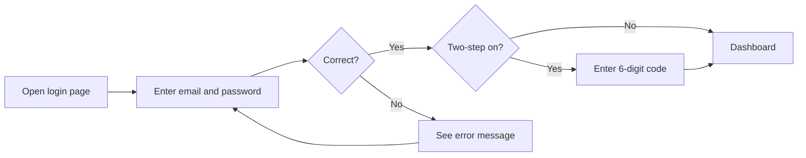
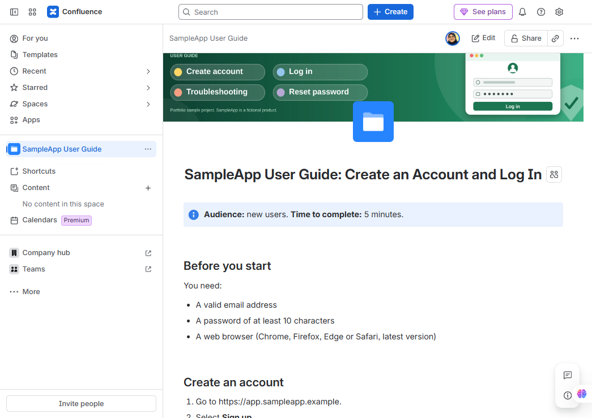
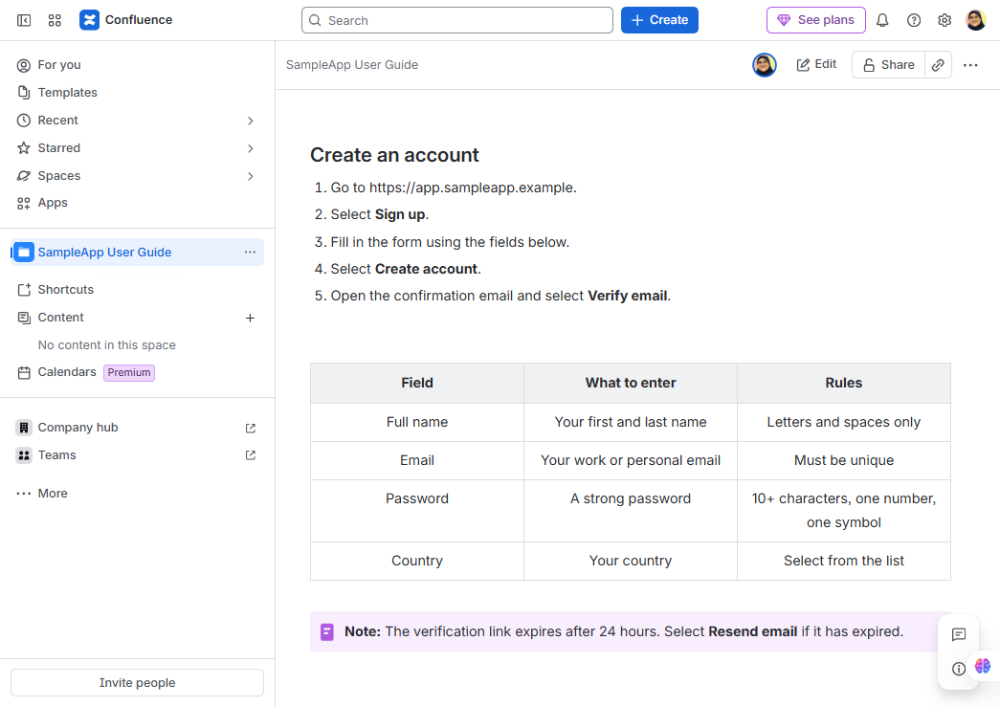
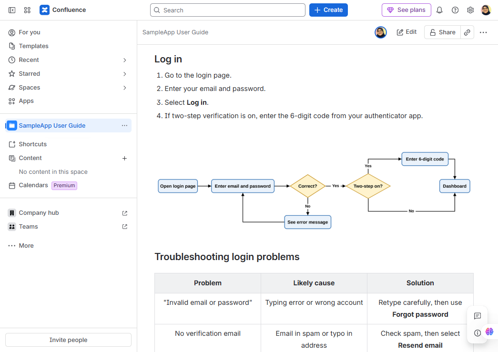
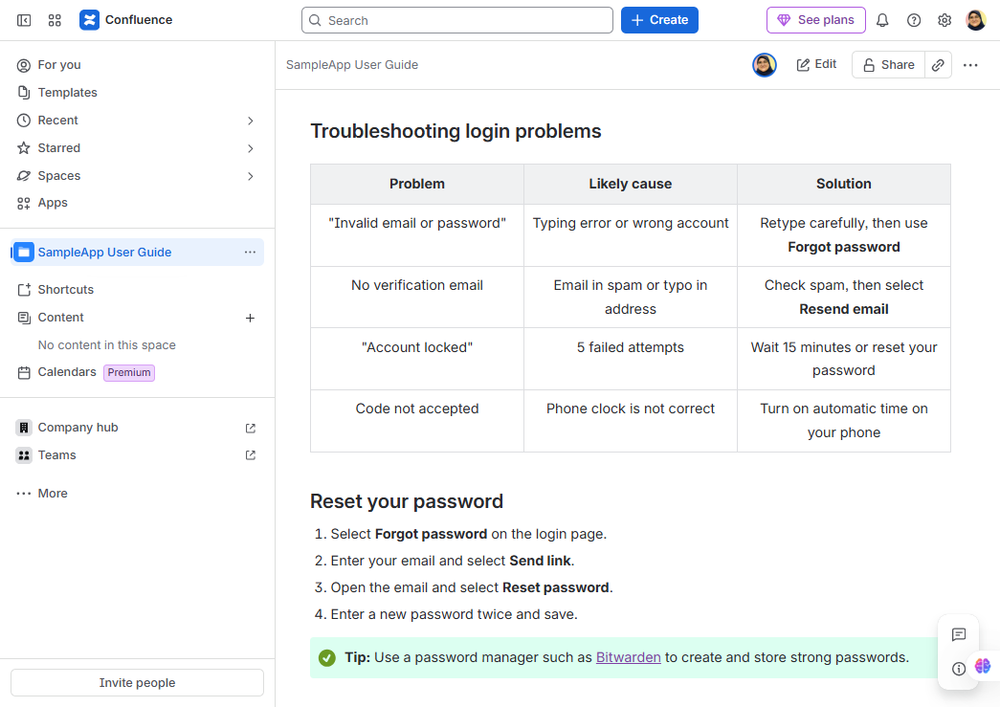
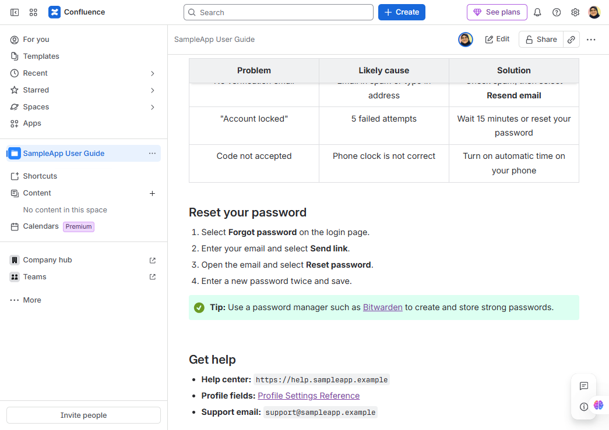

# SampleApp User Guide: Create an Account and Log In

> **Audience:** new users.  **Time to complete:** 5 minutes.

[View screenshots of the Confluence page](#screenshots-of-the-confluence-page)

## Before you start
You need:
- A valid email address
- A password of at least 10 characters
- A web browser (Chrome, Firefox, Edge or Safari, latest version)

## Create an account
1. Go to `https://app.sampleapp.example`.
2. Select **Sign up**.
3. Fill in the form using the fields below.
4. Select **Create account**.
5. Open the confirmation email and select **Verify email**.

| Field | What to enter | Rules |
|-------|---------------|-------|
| Full name | Your first and last name | Letters and spaces only |
| Email | Your work or personal email | Must be unique |
| Password | A strong password | 10+ characters, one number, one symbol |
| Country | Your country | Select from the list |

> **Note:** The verification link expires after 24 hours. Select **Resend email** if it has expired.

## Log in
1. Go to the login page.
2. Enter your email and password.
3. Select **Log in**.
4. If two-step verification is on, enter the 6-digit code from your authenticator app.

## Troubleshooting login problems
| Problem | Likely cause | Solution |
|---------|--------------|----------|
| "Invalid email or password" | Typing error or wrong account | Retype carefully, then use **Forgot password** |
| No verification email | Email in spam or typo in address | Check spam, then select **Resend email** |
| "Account locked" | 5 failed attempts | Wait 15 minutes or reset your password |
| Code not accepted | Phone clock is not correct | Turn on automatic time on your phone |

## Reset your password
1. Select **Forgot password** on the login page.
2. Enter your email and select **Send link**.
3. Open the email and select **Reset password**.
4. Enter a new password twice and save.

> **Tip:** Use a password manager such as [Bitwarden](https://bitwarden.com/) to create and store strong passwords.

## Get help
- Help center: `https://help.sampleapp.example`
- Profile fields: [Profile Settings Reference](https://github.com/mai-aamer/profile-settings-reference)
- Support email: `support@sampleapp.example`

## Screenshots of the Confluence page

This guide was designed and published in Confluence. The screenshots below show the final page, from top to bottom.

